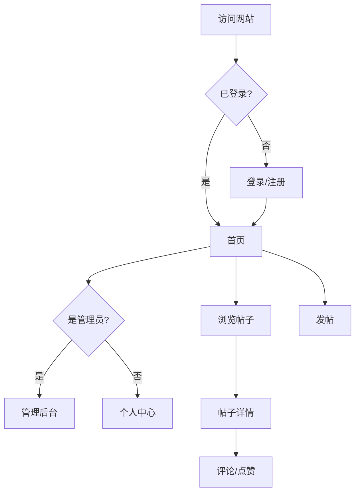

## 1. 产品概述

TechForum 是一个面向技术爱好者与学生群体的现代化论坛网站，支持帖子发布、分类浏览、评论互动、用户管理与数据统计。系统采用前后端分离架构，提供管理员、普通用户、访客三种角色权限，界面简洁美观、操作流畅。

- **目标用户**：学生、技术爱好者、社区管理者
- **核心价值**：提供一个轻量、美观、易用的在线讨论社区，支持知识分享与交流

## 2. 核心功能

### 2.1 用户角色

| 角色 | 注册方式 | 核心权限 |
|------|----------|----------|
| 管理员 | 预设账号 | 全部权限：用户管理、帖子管理、分类管理、数据统计、批量导入导出 |
| 普通用户 | 邮箱/用户名注册 | 发帖、评论、收藏、修改个人信息 |
| 访客 | 无需注册 | 浏览帖子、查看评论 |

### 2.2 功能模块

1. **登录/注册页**：用户认证、角色区分
2. **首页**：帖子列表、分类导航、热门推荐、搜索
3. **帖子详情页**：帖子内容、评论列表、点赞/收藏
4. **发帖页**：富文本编辑器、分类选择、标签
5. **个人中心**：个人信息、我的帖子、我的收藏
6. **管理后台**：仪表盘、用户管理、帖子管理、分类管理、数据统计

### 2.3 页面详情

| 页面名称 | 模块名称 | 功能描述 |
|----------|----------|----------|
| 登录页 | 登录表单 | 用户名+密码登录，表单校验 |
| | 注册表单 | 新用户注册，角色选择 |
| 首页 | 导航栏 | Logo、分类导航、搜索框、用户头像下拉 |
| | 侧边栏 | 分类列表、热门标签、活跃用户 |
| | 帖子流 | 卡片式帖子列表，支持分页/无限滚动 |
| | 排行榜 | 热门帖子、最新帖子、精华帖子切换 |
| 帖子详情 | 帖子主体 | 标题、作者信息、正文、标签、发布时间 |
| | 互动区 | 点赞、收藏、评论数、分享 |
| | 评论区 | 评论列表、回复、评论输入框 |
| 发帖页 | 编辑区 | 标题输入、分类选择、标签输入、Markdown 编辑器 |
| | 预览区 | 实时预览、字数统计 |
| 个人中心 | 信息展示 | 头像、昵称、积分、注册时间 |
| | 标签页 | 我的帖子、我的收藏、个人设置 |
| 管理后台 | 仪表盘 | 统计卡片（用户数、帖子数、评论数、今日新增）+ 趋势图表 |
| | 用户管理 | 搜索、分页、启用/禁用、角色变更、批量导入导出 |
| | 帖子管理 | 审核、置顶、删除、按分类筛选 |
| | 分类管理 | 新增、编辑、删除分类 |
| | 数据统计 | 帖子趋势图、活跃用户排行、分类分布饼图 |

## 3. 核心流程

### 3.1 用户访问流程
访客进入首页 → 浏览帖子/搜索 → 点击查看详情 → 登录/注册 → 发帖/评论/收藏

### 3.2 发帖流程
登录 → 点击"发帖" → 填写标题/分类/标签 → 编辑正文 → 预览 → 发布

### 3.3 管理流程
管理员登录 → 进入后台 → 用户管理/帖子管理/统计 → 批量操作/审核

## 4. 用户界面设计

### 4.1 设计风格
- **主色调**：深靛蓝 (#1e293b) + 翡翠绿 (#10b981) 作为强调色
- **辅助色**：暖白 (#fafaf9) 背景、柔和灰 (#64748b) 正文
- **按钮风格**：圆角胶囊 (pill) 风格，带微阴影和 hover 渐变
- **字体**：
  - 标题：'Noto Serif SC' (宋体感，有气质)
  - 正文：'Noto Sans SC' (现代无衬线)
- **布局**：左右分栏布局，主内容卡片式
- **图标风格**：Lucide 线性图标，2px 线条
- **动效**：淡入 + 轻微上移的入场动画、hover 状态微缩放、卡片悬浮阴影

### 4.2 页面设计概览

| 页面名称 | 模块名称 | UI 元素 |
|----------|----------|---------|
| 首页 | Hero 区域 | 渐变背景、欢迎语、搜索框、装饰性几何图形 |
| | 帖子卡片 | 毛玻璃卡片、帖子标题截断、作者头像、分类标签、互动数据 |
| | 侧边栏 | 紧凑卡片、分类图标、滚动条美化 |
| 帖子详情 | 正文区 | 衬线字体、合理行高、代码块高亮 |
| | 评论区 | 头像列表、嵌套回复、输入框占位符动效 |
| 发帖页 | 编辑器 | 双栏布局（编辑+预览）、工具栏悬浮、自动保存提示 |
| 管理后台 | 仪表盘 | 数据卡片渐变、图表用 Chart.js、数字翻转动效 |
| | 表格 | Element Plus DataTable、斑马纹、行内编辑、批量选择 |

### 4.3 响应式设计
- 桌面优先设计（1200px+ 完美展示）
- 平板模式（768-1199px）：侧边栏折叠为抽屉
- 移动模式（< 768px）：单列布局，导航变为底部 Tab Bar
