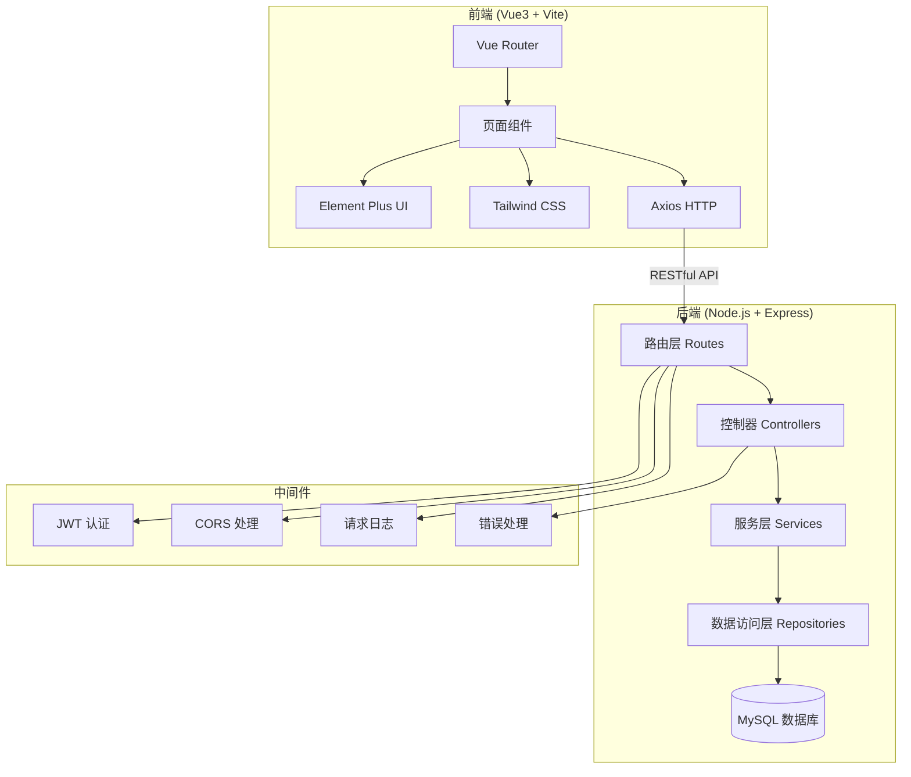
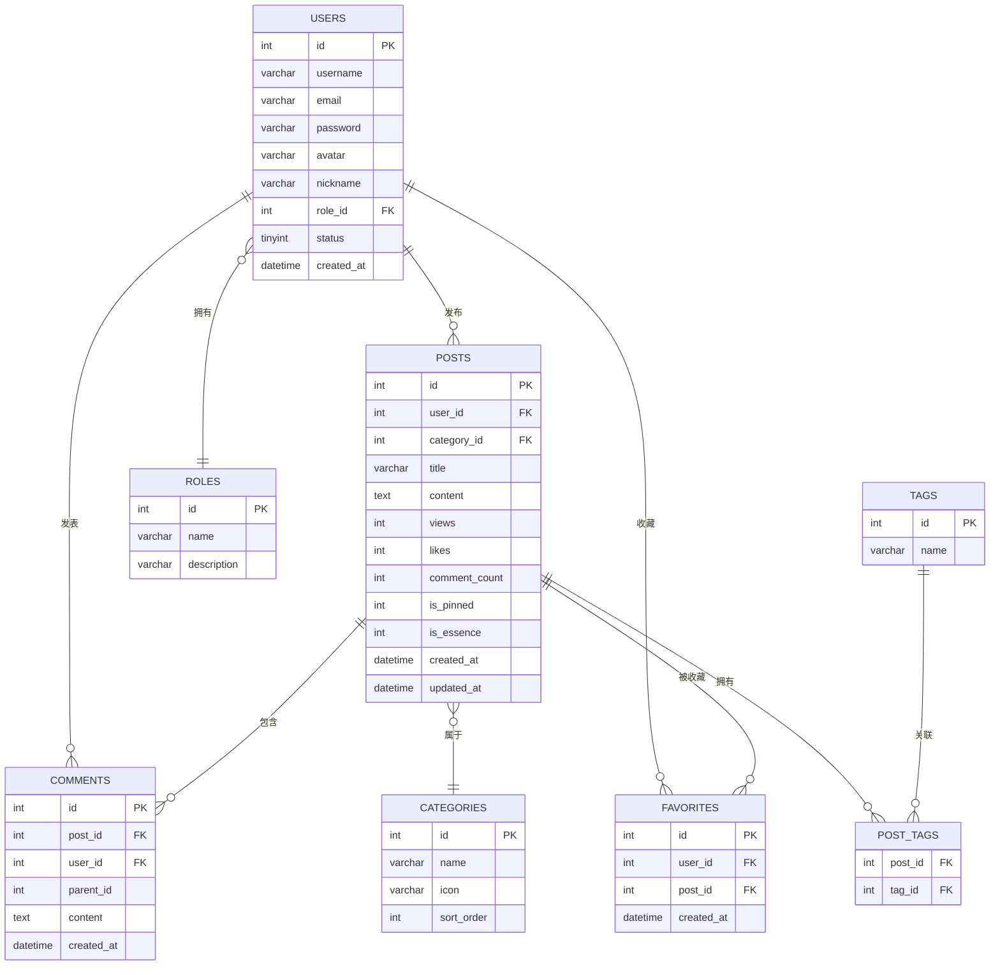

## 1. 架构设计



## 2. 技术选型

| 层次 | 技术 | 说明 |
|------|------|------|
| 前端框架 | Vue 3 + TypeScript | Composition API + `<script setup>` |
| 构建工具 | Vite 6 | 快速热更新 |
| UI 组件库 | Element Plus | 表单、表格、对话框 |
| CSS 框架 | Tailwind CSS 3 | 原子化样式 |
| 状态管理 | Pinia | 模块化状态管理 |
| HTTP 客户端 | Axios | 统一请求拦截 |
| 图表 | Chart.js + vue-chartjs | 数据可视化 |
| 后端框架 | Express 4 | Node.js Web 框架 |
| ORM | mysql2 + 手写 SQL | 轻量高效，避免过度抽象 |
| 认证 | JWT (jsonwebtoken) | Token 鉴权 |
| 密码加密 | bcryptjs | 安全存储 |
| 参数校验 | express-validator | 输入校验 |
| 文件处理 | multer | 文件上传 |
| 数据库 | MySQL 8 | 关系型数据库 |

## 3. 路由定义

### 前端路由

| 路径 | 页面 | 权限 |
|------|------|------|
| `/login` | 登录页 | 公开 |
| `/register` | 注册页 | 公开 |
| `/` | 首页（帖子列表） | 公开 |
| `/post/:id` | 帖子详情 | 公开 |
| `/post/create` | 发帖页 | 登录用户 |
| `/post/edit/:id` | 编辑帖子 | 作者 |
| `/category/:id` | 分类浏览 | 公开 |
| `/user/:id` | 用户主页 | 公开 |
| `/profile` | 个人中心 | 登录用户 |
| `/admin` | 管理后台仪表盘 | 管理员 |
| `/admin/users` | 用户管理 | 管理员 |
| `/admin/posts` | 帖子管理 | 管理员 |
| `/admin/categories` | 分类管理 | 管理员 |
| `/admin/stats` | 数据统计 | 管理员 |

### 后端 API 路由

| 方法 | 路径 | 说明 | 权限 |
|------|------|------|------|
| POST | `/api/auth/register` | 用户注册 | 公开 |
| POST | `/api/auth/login` | 用户登录 | 公开 |
| GET | `/api/auth/me` | 获取当前用户 | 登录 |
| GET | `/api/posts` | 帖子列表（分页+筛选） | 公开 |
| GET | `/api/posts/:id` | 帖子详情 | 公开 |
| POST | `/api/posts` | 创建帖子 | 登录 |
| PUT | `/api/posts/:id` | 更新帖子 | 作者/管理员 |
| DELETE | `/api/posts/:id` | 删除帖子 | 作者/管理员 |
| POST | `/api/posts/:id/like` | 点赞/取消 | 登录 |
| POST | `/api/posts/:id/favorite` | 收藏/取消 | 登录 |
| GET | `/api/posts/:id/comments` | 评论列表 | 公开 |
| POST | `/api/posts/:id/comments` | 发表评论 | 登录 |
| DELETE | `/api/comments/:id` | 删除评论 | 作者/管理员 |
| GET | `/api/categories` | 分类列表 | 公开 |
| GET | `/api/users/:id` | 用户信息 | 公开 |
| GET | `/api/users/:id/posts` | 用户帖子 | 公开 |
| GET | `/api/admin/users` | 用户管理列表 | 管理员 |
| POST | `/api/admin/users/import` | 批量导入用户 | 管理员 |
| GET | `/api/admin/users/export` | 批量导出用户 | 管理员 |
| PUT | `/api/admin/users/:id` | 更新用户（角色、状态） | 管理员 |
| GET | `/api/admin/stats/dashboard` | 仪表盘数据 | 管理员 |
| GET | `/api/admin/stats/trend` | 趋势数据 | 管理员 |

## 4. 数据模型

### 4.1 ER 图



### 4.2 DDL

```sql
CREATE DATABASE IF NOT EXISTS techforum DEFAULT CHARSET utf8mb4 COLLATE utf8mb4_unicode_ci;
USE techforum;

-- 角色表
CREATE TABLE roles (
  id INT PRIMARY KEY AUTO_INCREMENT,
  name VARCHAR(50) NOT NULL UNIQUE,
  description VARCHAR(200),
  created_at DATETIME DEFAULT CURRENT_TIMESTAMP
);

-- 用户表
CREATE TABLE users (
  id INT PRIMARY KEY AUTO_INCREMENT,
  username VARCHAR(50) NOT NULL UNIQUE,
  email VARCHAR(100) NOT NULL UNIQUE,
  password VARCHAR(255) NOT NULL,
  nickname VARCHAR(50),
  avatar VARCHAR(255) DEFAULT '/default-avatar.png',
  role_id INT DEFAULT 2,
  status TINYINT DEFAULT 1 COMMENT '1启用 0禁用',
  points INT DEFAULT 0,
  created_at DATETIME DEFAULT CURRENT_TIMESTAMP,
  updated_at DATETIME DEFAULT CURRENT_TIMESTAMP ON UPDATE CURRENT_TIMESTAMP,
  FOREIGN KEY (role_id) REFERENCES roles(id)
);

-- 分类表
CREATE TABLE categories (
  id INT PRIMARY KEY AUTO_INCREMENT,
  name VARCHAR(50) NOT NULL UNIQUE,
  icon VARCHAR(100),
  sort_order INT DEFAULT 0,
  created_at DATETIME DEFAULT CURRENT_TIMESTAMP
);

-- 帖子表
CREATE TABLE posts (
  id INT PRIMARY KEY AUTO_INCREMENT,
  user_id INT NOT NULL,
  category_id INT,
  title VARCHAR(200) NOT NULL,
  content TEXT NOT NULL,
  views INT DEFAULT 0,
  likes INT DEFAULT 0,
  comment_count INT DEFAULT 0,
  is_pinned TINYINT DEFAULT 0,
  is_essence TINYINT DEFAULT 0,
  status TINYINT DEFAULT 1 COMMENT '1正常 0隐藏',
  created_at DATETIME DEFAULT CURRENT_TIMESTAMP,
  updated_at DATETIME DEFAULT CURRENT_TIMESTAMP ON UPDATE CURRENT_TIMESTAMP,
  FOREIGN KEY (user_id) REFERENCES users(id) ON DELETE CASCADE,
  FOREIGN KEY (category_id) REFERENCES categories(id) ON DELETE SET NULL
);

-- 评论表
CREATE TABLE comments (
  id INT PRIMARY KEY AUTO_INCREMENT,
  post_id INT NOT NULL,
  user_id INT NOT NULL,
  parent_id INT DEFAULT NULL,
  content TEXT NOT NULL,
  created_at DATETIME DEFAULT CURRENT_TIMESTAMP,
  FOREIGN KEY (post_id) REFERENCES posts(id) ON DELETE CASCADE,
  FOREIGN KEY (user_id) REFERENCES users(id) ON DELETE CASCADE
);

-- 收藏表
CREATE TABLE favorites (
  id INT PRIMARY KEY AUTO_INCREMENT,
  user_id INT NOT NULL,
  post_id INT NOT NULL,
  created_at DATETIME DEFAULT CURRENT_TIMESTAMP,
  UNIQUE KEY uk_user_post (user_id, post_id),
  FOREIGN KEY (user_id) REFERENCES users(id) ON DELETE CASCADE,
  FOREIGN KEY (post_id) REFERENCES posts(id) ON DELETE CASCADE
);

-- 标签表
CREATE TABLE tags (
  id INT PRIMARY KEY AUTO_INCREMENT,
  name VARCHAR(50) NOT NULL UNIQUE,
  created_at DATETIME DEFAULT CURRENT_TIMESTAMP
);

-- 帖子标签关联
CREATE TABLE post_tags (
  post_id INT NOT NULL,
  tag_id INT NOT NULL,
  PRIMARY KEY (post_id, tag_id),
  FOREIGN KEY (post_id) REFERENCES posts(id) ON DELETE CASCADE,
  FOREIGN KEY (tag_id) REFERENCES tags(id) ON DELETE CASCADE
);

-- 点赞记录
CREATE TABLE likes (
  id INT PRIMARY KEY AUTO_INCREMENT,
  user_id INT NOT NULL,
  post_id INT NOT NULL,
  created_at DATETIME DEFAULT CURRENT_TIMESTAMP,
  UNIQUE KEY uk_user_post (user_id, post_id)
);

-- 初始数据
INSERT INTO roles (name, description) VALUES ('admin', '系统管理员'), ('user', '普通用户');

INSERT INTO users (username, email, password, nickname, role_id) VALUES
('admin', 'admin@techforum.com', '$2a$10$...', '超级管理员', 1),
('demo', 'demo@techforum.com', '$2a$10$...', '演示用户', 2);

INSERT INTO categories (name, icon, sort_order) VALUES
('前端开发', 'monitor', 1),
('后端开发', 'server', 2),
('移动开发', 'smartphone', 3),
('算法与数据', 'brain', 4),
('人工智能', 'sparkles', 5),
('设计与产品', 'palette', 6),
('职业发展', 'briefcase', 7),
('闲聊灌水', 'coffee', 8);

INSERT INTO tags (name) VALUES ('Vue'), ('React'), ('Node.js'), ('MySQL'), ('Python'), ('TypeScript'), ('Docker'), ('Linux');
```

## 5. 项目结构

```
毕设/
├── api/                          # 后端
│   ├── src/
│   │   ├── config/
│   │   │   └── db.ts             # 数据库连接
│   │   ├── middleware/
│   │   │   ├── auth.ts           # JWT 认证
│   │   │   ├── admin.ts          # 管理员校验
│   │   │   └── error.ts          # 错误处理
│   │   ├── routes/
│   │   │   ├── auth.ts
│   │   │   ├── posts.ts
│   │   │   ├── comments.ts
│   │   │   ├── categories.ts
│   │   │   ├── users.ts
│   │   │   └── admin.ts
│   │   ├── utils/
│   │   │   ├── response.ts       # 统一响应
│   │   │   └── seed.ts           # 初始数据
│   │   └── index.ts
│   ├── migrations/
│   │   └── init.sql
│   └── package.json
├── src/                          # 前端
│   ├── components/
│   │   ├── Navbar.vue
│   │   ├── PostCard.vue
│   │   ├── Sidebar.vue
│   │   ├── CommentItem.vue
│   │   └── StatsCard.vue
│   ├── views/
│   │   ├── Login.vue
│   │   ├── Register.vue
│   │   ├── Home.vue
│   │   ├── PostDetail.vue
│   │   ├── CreatePost.vue
│   │   ├── Profile.vue
│   │   └── admin/
│   │       ├── Dashboard.vue
│   │       ├── UserManage.vue
│   │       ├── PostManage.vue
│   │       ├── CategoryManage.vue
│   │       └── Stats.vue
│   ├── router/
│   │   └── index.ts
│   ├── stores/
│   │   └── user.ts
│   ├── api/
│   │   ├── auth.ts
│   │   ├── posts.ts
│   │   ├── users.ts
│   │   └── admin.ts
│   ├── utils/
│   │   └── request.ts
│   ├── App.vue
│   └── main.ts
├── index.html
├── vite.config.ts
├── tailwind.config.js
└── package.json
```
